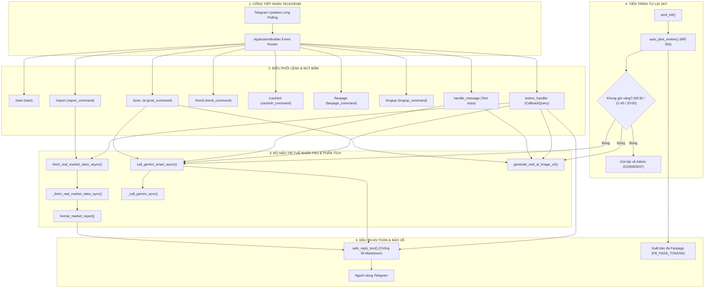

# 🗺️ CODEBASE KNOWLEDGE GRAPH & ARCHITECTURE MAP (AI-AGENT-SYSTEM)

> **Bản đồ Tri thức Mã nguồn & Cây quan hệ Phụ thuộc (AST Knowledge Graph)**
> *Được khởi tạo theo chuẩn Codebase Memory MCP & OpenWiki — Giúp AI Agents nắm trọn ngữ cảnh toàn dự án mà không cần quét lại toàn bộ file.*

---

## 🏛️ 1. TỔNG QUAN KIẾN TRÚC & ĐIỂM VÀO (ENTRY POINTS)

* **Ngôn ngữ:** Python 3.10+ / 3.13 (Asynchronous `asyncio` Event Loop)
* **Khung ứng dụng:** `python-telegram-bot` v20+ (ApplicationBuilder with Polling & Background Tasks)
* **Môi trường vận hành:** Đám mây Botkeep Cloud (`node3.botkeep.cloud`), tài nguyên < 50MB RAM.
* **Điểm vào thực thi chính (Entry Points):**
  * [`main.py`](file:///Users/gbholding/.gemini/antigravity/scratch/ai-agent-system/main.py#L574) ➔ `def main()`
  * [`chay_he_thong.py`](file:///Users/gbholding/.gemini/antigravity/scratch/ai-agent-system/chay_he_thong.py#L574) ➔ `def main()` (Bản sao đồng bộ chạy trên Botkeep)

---

## 🌳 2. CÂY PHỤ THUỘC & CHUỖI GỌI HÀM (CALL GRAPH HIERARCHY)

---

## 🧭 3. BẢNG TRA CỨU HÀM & TÁC ĐỘNG (IMPACT ANALYSIS MATRIX)

| Tên Hàm / Biểu tượng | Phạm vi trách nhiệm | Được gọi bởi (Callers) | Các hàm phụ thuộc (Callees) | Rủi ro nếu sửa đổi |
| :--- | :--- | :--- | :--- | :--- |
| `safe_reply_text` | Bọc phản hồi Markdown an toàn, tự động fallback nếu lỗi cú pháp | `start`, `report_command`, `trend_command`, `fanpage_command`, `cauhinh_command`, `trogiup_command`, `btn_report` | `target.reply_text` | **Thấp** (Rất an toàn) |
| `fetch_real_market_rates_async` | Lấy dữ liệu tài chính đa nguồn bất đồng bộ không nghẽn luồng | `report_command`, `button_handler` (`btn_report`) | `_fetch_real_market_rates_sync`, `market_cache` | **Trung bình** (Ảnh hưởng tốc độ phản hồi /report) |
| `_fetch_real_market_rates_sync` | Kết nối Binance 24h, Fear & Greed API, ExchangeRate API | `fetch_real_market_rates_async` | `requests.get` | **Trung bình** (Cần giữ timeout ≤ 2.5s) |
| `format_market_report` | Định dạng bản tin cố vấn chiến lược, tâm lý dòng tiền & CTA | `report_command`, `button_handler` | `r`, `cfg` | **Thấp** (Chỉ ảnh hưởng nội dung hiển thị) |
| `call_gemini_smart_async` | Sản xuất nội dung AIDA/PAS qua Gemini 2.5 Flash | `post_command`, `handle_message`, `button_handler`, `auto_pilot_worker` | `_call_gemini_sync` | **Cao** (Là linh hồn sinh bài tự động toàn hệ thống) |
| `generate_real_ai_image_url` | Sinh URL ảnh AI 4K theo từ khóa chủ đề | `post_command`, `handle_message`, `button_handler`, `auto_pilot_worker` | `requests.utils.quote` | **Thấp** |
| `auto_pilot_worker` | Vòng lặp ngầm 24/7 kiểm tra giờ vàng (08:30, 11:45, 20:00) | `post_init` | `doc_cau_hinh`, `call_gemini_smart_async`, `generate_real_ai_image_url` | **Cao** (Quyết định tính tự lái của bot) |
| `doc_cau_hinh` / `luu_cau_hinh` | Đọc / Ghi cấu hình thương hiệu, giọng văn, hotline (`cau_hinh_thuong_hieu.json`) | Hầu hết các handlers | `json.load`, `json.dump` | **Trung bình** |

---

## 🌐 4. DANH MỤC ĐIỂM CHẠM NGOẠI VI (EXTERNAL APIS)

1. **Telegram Bot API:** `https://api.telegram.org/bot<TOKEN>/...` (Long Polling + Webhook info + Command sets).
2. **Binance Ticker 24hr API:** `https://api.binance.com/api/v3/ticker/24hr?symbol=BTCUSDT` (Giá BTC + Biến động % 24h).
3. **Alternative.me Crypto API:** `https://api.alternative.me/fng/?limit=1` (Chỉ số Sợ hãi & Tham lam Fear/Greed Index).
4. **ExchangeRate API:** `https://open.er-api.com/v6/latest/USD` (Tỷ giá USD/VND liên ngân hàng).
5. **Google Gemini REST API:** `https://generativelanguage.googleapis.com/v1beta/models/gemini-2.5-flash:generateContent` (Nội dung marketing).
6. **Pollinations AI:** `https://image.pollinations.ai/prompt/<PROMPT>?width=1200&height=630` (Sinh ảnh AI miễn phí chất lượng cao).
7. **Meta Graph API:** `https://graph.facebook.com/v21.0/...` (Đăng bài tự động lên Facebook Fanpage).

---

## 🛡️ 5. QUY TẮC BẢO TRÌ & NÂNG CẤP CHO AI AGENT (AGENTIC RULES)

1. **Quy tắc Single Source of Truth:**
   * Luôn sửa trên `main.py` trước, sau đó đồng bộ ngay sang `chay_he_thong.py` (`cp main.py chay_he_thong.py`).
2. **Quy tắc Kiểm tra Toàn vẹn Cú pháp:**
   * Bắt buộc chạy `python3 -m py_compile main.py chay_he_thong.py` trước khi thực hiện `git commit`.
3. **Quy tắc Không Làm Nghẽn Event Loop:**
   * Mọi tác vụ I/O mạng bên thứ 3 (Gemini, Tỷ giá, Ảnh) **phải đặt trong `loop.run_in_executor`** để Telegram Bot duy trì tốc độ phản hồi < 0.5s.
4. **Quy tắc An Toàn Phản Hồi:**
   * Luôn bọc qua hàm `safe_reply_text` để tránh lỗi sập bot khi tin nhắn AI chứa ký tự Markdown lạ (`_`, `*`, `[`).
